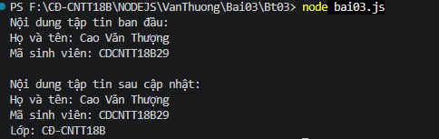

# BÀI THỰC HÀNH 03 - BT03: THAO TÁC FILE VỚI MODULE FS

## 1. Thông tin sinh viên
- **Họ và tên:** Cao Văn Thượng
- **Mã sinh viên:** CDCNTT18B29
- **Lớp:** CĐ-CNTT18B

---

## 2. Yêu cầu bài thực hành
- Tạo tập tin `bai03.js` sử dụng module `fs`.
- Tạo tập tin `thongtin.txt` chứa họ tên và mã sinh viên.
- Đọc và hiển thị nội dung tập tin lên Terminal.
- Ghi nối thêm tên lớp vào cuối tập tin bằng `appendFile()`.
- Đọc lại tập tin để chứng minh nội dung đã được cập nhật.
- Terminal chỉ hiển thị kết quả: nội dung tập tin ban đầu và nội dung sau cập nhật.

---

## 3. Các lệnh thực hiện
1. **Di chuyển vào thư mục bài tập:**
   ```bash
   cd Bai03/Bt03
   ```
2. **Khởi chạy chương trình:**
   ```bash
   node bai03.js
   ```

---

## 4. Ảnh minh chứng các bước thực hiện


---

## 5. Kết quả cuối cùng trên Terminal
```
Nội dung tập tin ban đầu:
Họ và tên: Cao Văn Thượng
Mã sinh viên: CDCNTT18B29

Nội dung tập tin sau cập nhật:
Họ và tên: Cao Văn Thượng
Mã sinh viên: CDCNTT18B29
Lớp: CĐ-CNTT18B
```

- **Nội dung lưu trong tập tin `thongtin.txt` sau khi chạy:**
  ```
  Họ và tên: Cao Văn Thượng
  Mã sinh viên: CDCNTT18B29
  Lớp: CĐ-CNTT18B
  ```
