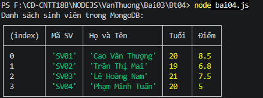
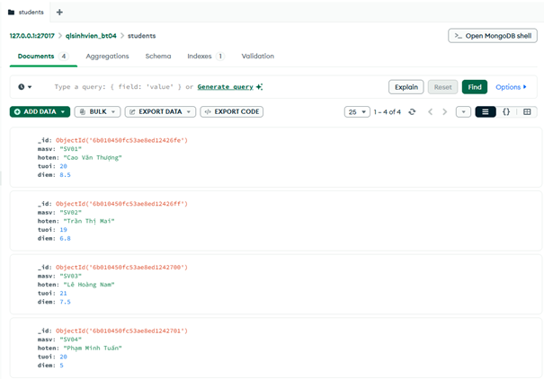

# BÀI THỰC HÀNH 03 - BT04: KẾT NỐI VÀ THÊM DỮ LIỆU VÀO MONGODB

## 1. Thông tin sinh viên
- **Họ và tên:** Cao Văn Thượng
- **Mã sinh viên:** CDCNTT18B29
- **Lớp:** CĐ-CNTT18B

---

## 2. Yêu cầu bài thực hành
- Tạo tập tin `bai04.js`:
  - Kết nối MongoDB đang chạy trên máy (`mongodb://127.0.0.1:27017`).
  - Bản database riêng: `qlsinhvien_bt04`, collection: `students`.
  - Có bản `node_modules`, `package.json`, `package-lock.json` riêng biệt.
  - Thêm ít nhất 3 sinh viên bằng `insertMany()`, mỗi sinh viên gồm `masv`, `hoten`, `tuoi`, `diem`.
  - Sử dụng `find()` hiển thị danh sách sinh viên lên Terminal và đóng kết nối sau khi hoàn thành.
  - Terminal chỉ hiển thị kết quả danh sách sinh viên.

---

## 3. Các lệnh thực hiện
1. **Di chuyển vào thư mục bài tập:**
   ```bash
   cd Bai03/Bt04
   ```
2. **Cài đặt thư viện mongodb độc lập (nếu cần):**
   ```bash
   npm install mongodb
   ```
3. **Thực thi tập tin `bai04.js`:**
   ```bash
   node bai04.js
   ```

---

## 4. Ảnh minh chứng các bước và kết quả
- **Ảnh chạy lệnh trên Terminal:**  
  

- **Ảnh kết quả hiển thị dữ liệu sinh viên trong MongoDB:**  
  

---

## 5. Kết quả cuối cùng trên Terminal
```
Danh sách sinh viên trong MongoDB:
┌─────────┬────────┬──────────────────┬──────┬──────┐
│ (index) │ Mã SV  │ Họ và Tên        │ Tuổi │ Điểm │
├─────────┼────────┼──────────────────┼──────┼──────┤
│ 0       │ 'SV01' │ 'Cao Văn Thượng' │ 20   │ 8.5  │
│ 1       │ 'SV02' │ 'Trần Thị Mai'   │ 19   │ 6.8  │
│ 2       │ 'SV03' │ 'Lê Hoàng Nam'   │ 21   │ 7.5  │
│ 3       │ 'SV04' │ 'Phạm Minh Tuấn' │ 20   │ 5    │
└─────────┴────────┴──────────────────┴──────┴──────┘
```
- **Nhận xét kết quả:** Đã thêm thành công các bản ghi sinh viên vào database `qlsinhvien_bt04` và truy vấn hiển thị đầy đủ thông tin.
