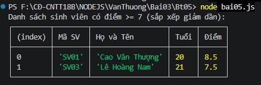
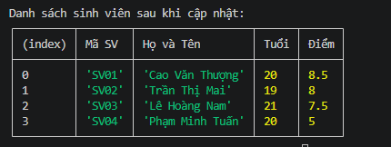

# BÀI THỰC HÀNH 03 - BT05: TRUY VẤN VÀ CẬP NHẬT DỮ LIỆU MONGODB

## 1. Thông tin sinh viên
- **Họ và tên:** Cao Văn Thượng
- **Mã sinh viên:** CDCNTT18B29
- **Lớp:** CĐ-CNTT18B

---

## 2. Yêu cầu bài thực hành
- Tạo tập tin `bai05.js`:
  - Bản database riêng: `qlsinhvien_bt05`, collection: `students`.
  - Có bản `node_modules`, `package.json`, `package-lock.json` riêng biệt để chạy độc lập.
  - Tìm các sinh viên có `diem >= 7` bằng `find()` và toán tử `$gte`.
  - Sắp xếp kết quả theo điểm giảm dần bằng `.sort({ diem: -1 })`.
  - Cập nhật điểm của một sinh viên theo `masv` bằng `updateOne()` và toán tử `$set`.
  - Hiển thị lại thông tin sau cập nhật để kiểm tra kết quả.
  - Terminal chỉ hiển thị kết quả (không hiển thị các bước kết nối hay câu lệnh nội bộ).

---

## 3. Các lệnh thực hiện
1. **Di chuyển vào thư mục bài tập:**
   ```bash
   cd Bai03/Bt05
   ```
2. **Cài đặt thư viện mongodb độc lập (nếu cần):**
   ```bash
   npm install mongodb
   ```
3. **Thực thi tập tin `bai05.js`:**
   ```bash
   node bai05.js
   ```

---

## 4. Ảnh minh chứng các bước và kết quả
- **Ảnh minh chứng 1 (Lọc sinh viên điểm >= 7 & sắp xếp giảm dần):**  
  

- **Ảnh minh chứng 2 (Cập nhật điểm sinh viên và kiểm tra kết quả):**  
  

---

## 5. Kết quả cuối cùng trên Terminal
```
Danh sách sinh viên có điểm >= 7 (sắp xếp giảm dần):
┌─────────┬────────┬──────────────────┬──────┬──────┐
│ (index) │ Mã SV  │ Họ và Tên        │ Tuổi │ Điểm │
├─────────┼────────┼──────────────────┼──────┼──────┤
│ 0       │ 'SV01' │ 'Cao Văn Thượng' │ 20   │ 8.5  │
│ 1       │ 'SV03' │ 'Lê Hoàng Nam'   │ 21   │ 7.5  │
└─────────┴────────┴──────────────────┴──────┴──────┘

Danh sách sinh viên sau khi cập nhật:
┌─────────┬────────┬──────────────────┬──────┬──────┐
│ (index) │ Mã SV  │ Họ và Tên        │ Tuổi │ Điểm │
├─────────┼────────┼──────────────────┼──────┼──────┤
│ 0       │ 'SV01' │ 'Cao Văn Thượng' │ 20   │ 8.5  │
│ 1       │ 'SV02' │ 'Trần Thị Mai'   │ 19   │ 8    │
│ 2       │ 'SV03' │ 'Lê Hoàng Nam'   │ 21   │ 7.5  │
│ 3       │ 'SV04' │ 'Phạm Minh Tuấn' │ 20   │ 5    │
└─────────┴────────┴──────────────────┴──────┴──────┘
```
- **Nhận xét kết quả:** Lọc chính xác các sinh viên có điểm $\ge 7$ và cập nhật thành công điểm của sinh viên `SV02` từ 6.8 lên 8.0 trong database riêng `qlsinhvien_bt05`.
