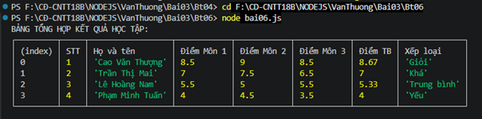
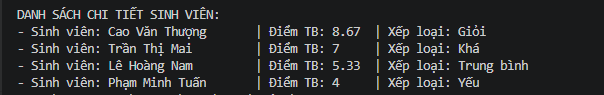

# BÀI THỰC HÀNH 03 - BT06: TÍNH ĐIỂM TRUNG BÌNH VÀ XẾP LOẠI HỌC TẬP

## 1. Thông tin sinh viên
- **Họ và tên:** Cao Văn Thượng
- **Mã sinh viên:** CDCNTT18B29
- **Lớp:** CĐ-CNTT18B

---

## 2. Yêu cầu bài thực hành
- Tạo hai tập tin `bai06.js` và `xulyDiem.js`.
- Trong `xulyDiem.js`:
  - Xây dựng hàm `tinhDiemTrungBinh(m1, m2, m3)` tính điểm trung bình của 3 môn.
  - Xây dựng hàm `xepLoai(dtb)` xếp loại học tập:
    - Giỏi: từ 8.0 trở lên
    - Khá: từ 6.5 đến dưới 8.0
    - Trung bình: từ 5.0 đến dưới 6.5
    - Yếu: dưới 5.0
  - Xuất các hàm bằng `module.exports`.
- Trong `bai06.js`:
  - Sử dụng `require()` để gọi các hàm từ `xulyDiem.js`.
  - Tạo dữ liệu ít nhất 3 sinh viên.
  - Hiển thị họ tên, điểm trung bình và xếp loại trên Terminal (chỉ hiện kết quả).

---

## 3. Các lệnh thực hiện
1. **Di chuyển vào thư mục bài tập:**
   ```bash
   cd Bai03/Bt06
   ```
2. **Thực thi tập tin `bai06.js`:**
   ```bash
   node bai06.js
   ```

---

## 4. Ảnh minh chứng các bước và kết quả
- **Ảnh thực thi tập tin `bai06.js`:**  
  

- **Ảnh kết quả tính điểm và bảng xếp loại học tập:**  
  

---

## 5. Kết quả cuối cùng trên Terminal
```
BẢNG TỔNG HỢP KẾT QUẢ HỌC TẬP:
┌─────────┬─────┬──────────────────┬────────────┬────────────┬────────────┬─────────┬──────────────┐
│ (index) │ STT │ Họ và tên        │ Điểm Môn 1 │ Điểm Môn 2 │ Điểm Môn 3 │ Điểm TB │ Xếp loại     │
├─────────┼─────┼──────────────────┼────────────┼────────────┼────────────┼─────────┼──────────────┤
│ 0       │ 1   │ 'Cao Văn Thượng' │ 8.5        │ 9          │ 8.5        │ 8.67    │ 'Giỏi'       │
│ 1       │ 2   │ 'Trần Thị Mai'   │ 7          │ 7.5        │ 6.5        │ 7       │ 'Khá'        │
│ 2       │ 3   │ 'Lê Hoàng Nam'   │ 5.5        │ 5          │ 5.5        │ 5.33    │ 'Trung bình' │
│ 3       │ 4   │ 'Phạm Minh Tuấn' │ 4          │ 4.5        │ 3.5        │ 4       │ 'Yếu'        │
└─────────┴─────┴──────────────────┴────────────┴────────────┴────────────┴─────────┴──────────────┘

DANH SÁCH CHI TIẾT SINH VIÊN:
- Sinh viên: Cao Văn Thượng       | Điểm TB: 8.67  | Xếp loại: Giỏi
- Sinh viên: Trần Thị Mai         | Điểm TB: 7     | Xếp loại: Khá
- Sinh viên: Lê Hoàng Nam         | Điểm TB: 5.33  | Xếp loại: Trung bình
- Sinh viên: Phạm Minh Tuấn       | Điểm TB: 4     | Xếp loại: Yếu
```
- **Nhận xét kết quả:** Module `xulyDiem.js` hoạt động chính xác, tính đúng điểm trung bình và phân loại chuẩn cả 4 mức xếp loại (Giỏi, Khá, Trung bình, Yếu).
