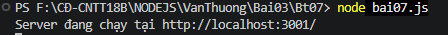
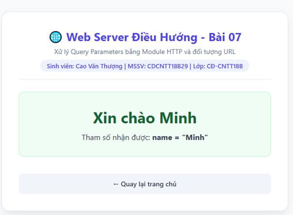
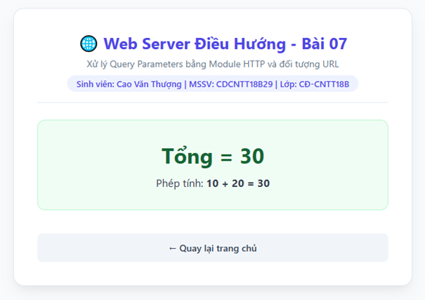
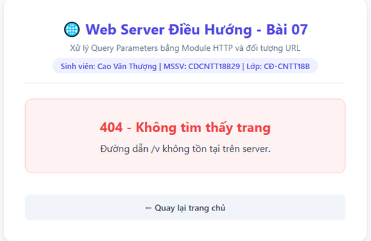
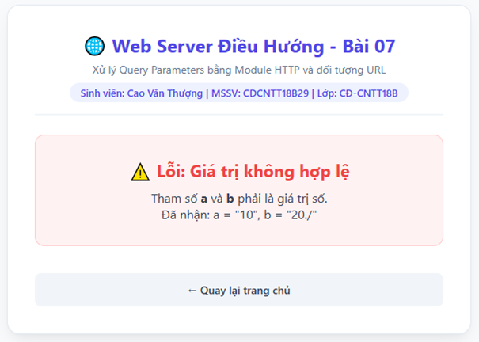

# BÀI THỰC HÀNH 03 - BT07: WEB SERVER XỬ LÝ QUERY PARAMETERS & ĐIỀU HƯỚNG

## 1. Thông tin sinh viên
- **Họ và tên:** Cao Văn Thượng
- **Mã sinh viên:** CDCNTT18B29
- **Lớp:** CĐ-CNTT18B

---

## 2. Yêu cầu bài thực hành
- Tạo tập tin `bai07.js`:
  - Sử dụng module `http` và đối tượng `URL`.
  - Tạo Web Server tại cổng `3001`.
  - Trang chủ (`/`): Giao diện hiện đại gồm 2 thẻ định danh Lời chào và Phép tính với nút click chuyển tiếp trang trực tiếp.
  - Khi truy cập `/hello?name=Minh`: Hiển thị giao diện thẻ Card có `Xin chào Minh` và nút quay về trang chủ.
  - Khi truy cập `/sum?a=10&b=20`: Hiển thị giao diện thẻ Card có `Tổng = 30` và nút quay về trang chủ.
  - Trả về thông báo lỗi định dạng thẻ Card (mã HTTP 400) nếu thiếu tham số hoặc giá trị không hợp lệ.

---

## 3. Các lệnh thực hiện
1. **Di chuyển vào thư mục bài tập:**
   ```bash
   cd Bai03/Bt07
   ```
2. **Khởi chạy Web Server:**
   ```bash
   node bai07.js
   ```
3. **Mở trình duyệt web truy cập trang chủ:**
   ```
   http://localhost:3001/
   ```

---

## 4. Ảnh minh chứng các bước và kết quả thực hiện

### 4.1. Khởi chạy Web Server trên Terminal


### 4.2. Giao diện trang chủ (Hỗ trợ click chuyển tiếp trang)


### 4.3. Kết quả chuyển tiếp Lời chào (`/hello?name=Minh`)


### 4.4. Kết quả chuyển tiếp Phép tính tổng (`/sum?a=10&b=20`)


### 4.5. Kiểm thử trường hợp lỗi: Thiếu tham số name (`/hello`)


### 4.6. Kiểm thử trường hợp lỗi: Giá trị không hợp lệ (`/sum?a=abc&b=20`)


---

## 5. Kết quả cuối cùng
- **Terminal:**
  ```
  Server đang chạy tại http://localhost:3001/
  ```
- **Trình duyệt Web:**
  - **Trang chủ (`/`):** 2 thẻ định danh có nút **`Chuyển trang: Lời chào →`** và **`Chuyển trang: Phép tính →`**.
  - **Trang `/hello?name=Minh`:** Thẻ màu xanh hiển thị rõ **Xin chào Minh**.
  - **Trang `/sum?a=10&b=20`:** Thẻ màu xanh hiển thị rõ **Tổng = 30** (chi tiết `10 + 20 = 30`).
  - **Trang lỗi (HTTP 400):** Thẻ màu đỏ thông báo lỗi chi tiết kèm nút **`← Quay lại trang chủ`**.
