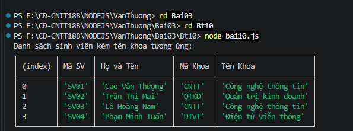
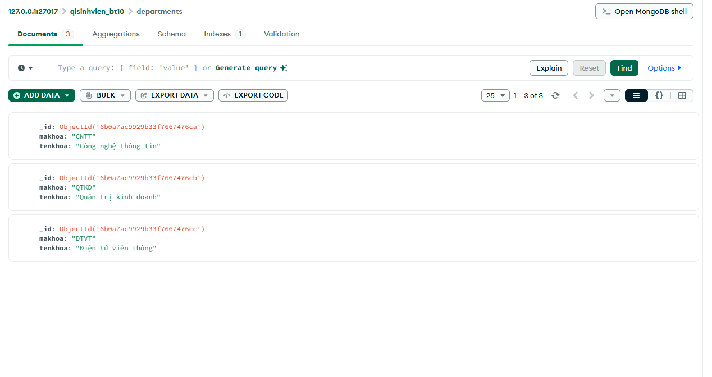
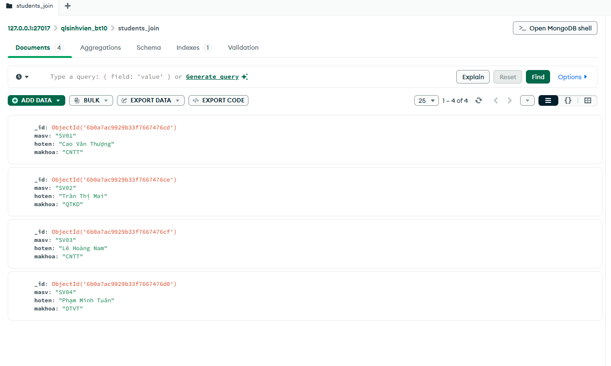

# BÀI THỰC HÀNH 03 - BT10: LIÊN KẾT HAI COLLECTION TRONG MONGODB

## 1. Thông tin sinh viên
- **Họ và tên:** Cao Văn Thượng
- **Mã sinh viên:** CDCNTT18B29
- **Lớp:** CĐ-CNTT18B

---

## 2. Yêu cầu bài thực hành
- Tạo tập tin `bai10.js`:
  - Bản database riêng: `qlsinhvien_bt10`.
  - Có bản `node_modules`, `package.json`, `package-lock.json` riêng biệt để chạy độc lập.
  - Tạo collection `departments` gồm ít nhất 2 khoa, mỗi khoa có `makhoa`, `tenkhoa`.
  - Tạo collection `students_join` gồm ít nhất 4 sinh viên, mỗi sinh viên có `masv`, `hoten`, `makhoa`.
  - Sử dụng `aggregate()` kết hợp `$lookup` để liên kết sinh viên với khoa thông qua `makhoa`.
  - Hiển thị danh sách sinh viên kèm tên khoa tương ứng.
  - Đảm bảo kết quả không chỉ hiển thị mã khoa mà còn có tên khoa.
  - Terminal chỉ hiển thị kết quả.

---

## 3. Các lệnh thực hiện
1. **Di chuyển vào thư mục bài tập:**
   ```bash
   cd Bai03/Bt10
   ```
2. **Cài đặt thư viện mongodb độc lập (nếu cần):**
   ```bash
   npm install mongodb
   ```
3. **Thực thi tập tin `bai10.js`:**
   ```bash
   node bai10.js
   ```

---

## 4. Ảnh minh chứng các bước và kết quả thực hiện
- **Ảnh minh chứng 1 (Thực thi lệnh trên Terminal):**  
  

- **Ảnh minh chứng 2 (Dữ liệu trong MongoDB):**  
  

- **Ảnh minh chứng 3 (Kết quả liên kết hai collection):**  
  

---

## 5. Kết quả cuối cùng trên Terminal
```
Danh sách sinh viên kèm tên khoa tương ứng:
┌─────────┬────────┬──────────────────┬─────────┬───────────────────────┐
│ (index) │ Mã SV  │ Họ và Tên        │ Mã Khoa │ Tên Khoa              │
├─────────┼────────┼──────────────────┼─────────┼───────────────────────┤
│ 0       │ 'SV01' │ 'Cao Văn Thượng' │ 'CNTT'  │ 'Công nghệ thông tin' │
│ 1       │ 'SV02' │ 'Trần Thị Mai'   │ 'QTKD'  │ 'Quản trị kinh doanh' │
│ 2       │ 'SV03' │ 'Lê Hoàng Nam'   │ 'CNTT'  │ 'Công nghệ thông tin' │
│ 3       │ 'SV04' │ 'Phạm Minh Tuấn' │ 'DTVT'  │ 'Điện tử viễn thông'  │
└─────────┴────────┴──────────────────┴─────────┴───────────────────────┘
```

- **Nhận xét kết quả:** Sử dụng thành công pipeline `aggregate()` với `$lookup` để nối dữ liệu từ 2 collection `students_join` và `departments` thông qua trường khóa liên kết `makhoa`, kết quả hiển thị đầy đủ Họ tên, Mã sinh viên, Mã khoa và Tên khoa tương ứng.
